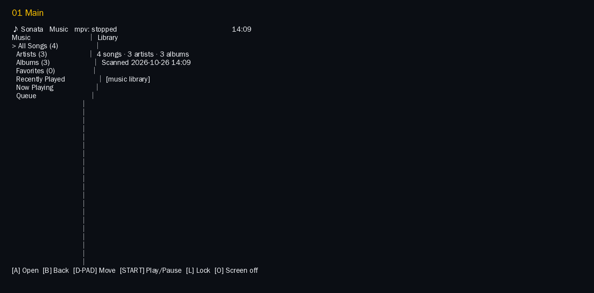
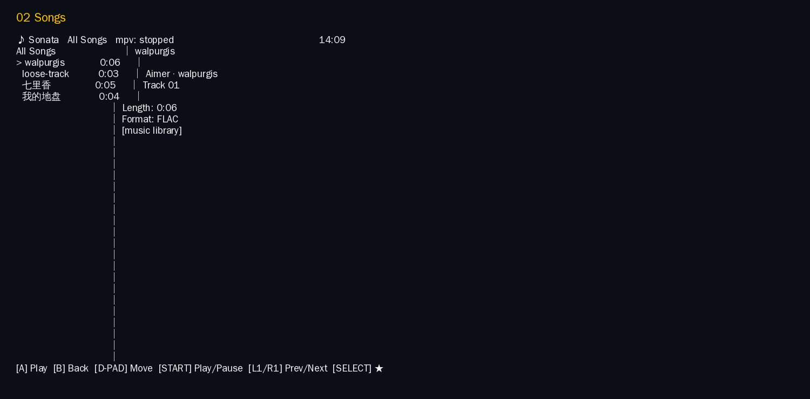
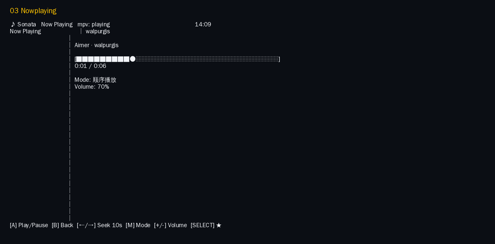
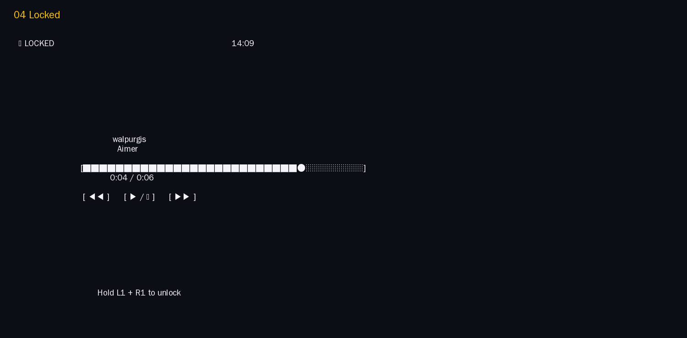

# Sonata

**Sonata** 是音乐库管理器、播放列表管理器与播放控制器，不是播放器。
解码与音频输出交给系统 `mpv`。

定位：iPod Classic 的浏览体验 + Kindle 的专注感 + Linux 掌机（RG34XX / RG35XX / RG40XX）的轻量应用。

- 单二进制（Go），ARM64 交叉编译，无 CGO、无数据库强依赖、无 Electron/Web。
- V1：终端 UI，按 720×480 横屏（90×30 字符网格）语义布局。
- 后台播放：退出界面后音乐继续（mpv 常驻）。

## 文档

| 文档 | 内容 |
|---|---|
| [PROJECT_PLAN.md](PROJECT_PLAN.md) | 目标、非目标、V1–V5 路线图、验收标准 |
| [ARCHITECTURE.md](ARCHITECTURE.md) | 模块分层、并发模型、错误处理、测试策略 |
| [UI_GUIDELINES.md](UI_GUIDELINES.md) | 四区布局、字号、配色、按键语义、锁屏/熄屏 |
| [CLI_WIREFRAMES.md](CLI_WIREFRAMES.md) | 9 个界面的 ASCII 线框图（90×30） |
| [MPV_INTEGRATION.md](MPV_INTEGRATION.md) | mpv 方案对比、IPC 协议、后台播放、失败模式 |
| [STORAGE_LAYOUT.md](STORAGE_LAYOUT.md) | 目录布局、JSON 格式、原子写、版本迁移、存储方案对比 |
| [RISKS.md](RISKS.md) | 风险清单与缓解、非目标 |

## Screenshots

Terminal UI captures from a 90×30 session, corresponding to Sonata's 720×480
landscape layout. PNGs are rendered from the captured terminal rows; `.txt` files
preserve the original text captures. The playback screen uses a local audio fixture.

| Main menu | Song list |
|---|---|
|  |  |

| Now playing | Lock screen |
|---|---|
|  |  |

## 构建

```sh
make build            # 本机
make build-arm64      # CGO_ENABLED=0 GOARCH=arm64
make test
```

## 使用（V1）

```sh
sonata scan --music ~/Music      # 扫描并写缓存
sonata                           # 打开 TUI
sonata status                    # 打印当前播放状态（JSON）
sonata play <file|dir>           # 立即播放（不打开 TUI）
sonata stop                      # 停止并退出 mpv
```

依赖：`mpv`（播放）。TUI 需要终端至少 90×30（更小进入紧凑模式）。

## heya integration

Sonata follows heya's Application Manifest v1 and is discovered as a normal
`media` application. See [`integrations/heya/`](integrations/heya/) and
[`docs/heya-compatibility.md`](docs/heya-compatibility.md) for the manifest,
storage mapping, and device acceptance checklist. Heya needs no Sonata-specific
launcher code; the manifest's `entrypoint` and `args` are enough.

ROCKNIX packaging draft: [`packaging/rocknix/package.mk`](packaging/rocknix/package.mk).
